# Product Requirements Document (PRD)

## SkyDrive — Unified Cloud Storage Management Platform

**Version:** 1.0  
**Status:** Planning Phase  
**Last Updated:** 30 August 2026  
**Author:** Portfolio Project

> *One workspace. Multiple clouds. Smarter storage.*

---

## Table of Contents

1. [Overview](#1-overview)
2. [Problem Statement](#2-problem-statement)
3. [Goals & Success Metrics](#3-goals--success-metrics)
4. [Target Users](#4-target-users)
5. [Feature Requirements](#5-feature-requirements)
6. [User Flow](#6-user-flow)
7. [Smart Storage Algorithm](#7-smart-storage-algorithm)
8. [System Architecture](#8-system-architecture)
9. [Database Design](#9-database-design)
10. [API Design](#10-api-design)
11. [Tech Stack](#11-tech-stack)
12. [Project Structure](#12-project-structure)
13. [Security Requirements](#13-security-requirements)
14. [Development Roadmap](#14-development-roadmap)
15. [MVP Scope](#15-mvp-scope)
16. [Future Features (v2+)](#16-future-features-v2)
17. [Technical Challenges](#17-technical-challenges)
18. [Non-Functional Requirements](#18-non-functional-requirements)

---

## 1. Overview

### What is SkyDrive?

SkyDrive adalah platform manajemen cloud storage terpadu berbasis web yang memungkinkan pengguna menghubungkan dan mengelola **multiple akun Google Drive** dari satu dashboard tunggal.

Alih-alih berpindah-pindah antar akun Google secara manual, SkyDrive menjadi lapisan manajemen terpusat yang memudahkan:

- Monitor penggunaan storage dari semua akun secara bersamaan
- Upload file dengan pemilihan akun otomatis (smart allocation)
- Pencarian file di seluruh akun yang terhubung
- Analitik penggunaan storage lintas akun

### Scope Awal

Fokus pertama adalah **Google Drive integration**. Dukungan provider lain (Dropbox, OneDrive, S3) direncanakan pada fase future.

---

## 2. Problem Statement

### Konteks

Pengguna dengan multiple akun Google memiliki storage yang tersebar. Contoh:

```
personal@gmail.com   → 15 GB
college@gmail.com    → 15 GB
work@gmail.com       → 15 GB
backup@gmail.com     → 15 GB
─────────────────────────────
Total                → 60 GB (tersebar)
```

Meskipun total kapasitas besar, pengguna tidak dapat menggunakannya secara efisien karena tersebar di multiple akun.

### Pain Points

| # | Masalah | Dampak |
|---|---------|--------|
| 1 | **Multiple Account Switching** — Harus login/logout berulang kali untuk cek storage atau upload file | Inefisien, membuang waktu |
| 2 | **Storage Visibility Problem** — Tidak tahu akun mana yang masih punya ruang tersedia | Upload gagal karena storage penuh |
| 3 | **File Location Problem** — Lupa file tersimpan di akun mana | Kehilangan waktu mencari file |
| 4 | **Inefficient Storage Distribution** — Satu akun penuh, akun lain kosong | Storage tidak termanfaatkan optimal |
| 5 | **No Unified Search** — Harus search di setiap Google Drive satu per satu | Tidak efisien, pengalaman buruk |

---

## 3. Goals & Success Metrics

### Project Goals

- Mengurangi frekuensi account switching
- Menyediakan monitoring storage terpusat
- Mempermudah pencarian file lintas akun
- Meningkatkan distribusi penggunaan storage
- Memilih akun storage terbaik secara otomatis
- Menyediakan storage analytics yang informatif
- Menciptakan unified cloud storage experience

### Success Metrics (KPI)

| Metric | Target |
|--------|--------|
| Waktu onboarding (connect akun pertama) | < 2 menit |
| Waktu pencarian file | < 3 detik |
| Upload success rate | > 95% |
| Smart allocation accuracy | > 90% sesuai strategi |
| Dashboard load time | < 2 detik |

---

## 4. Target Users

### Primary Users

#### 🎓 Mahasiswa
Memiliki multiple akun untuk:
- File personal dan hiburan
- Dokumen akademik dan tugas
- Backup skripsi/thesis
- Data penelitian

#### 👨‍💻 Developer
Memiliki multiple akun untuk:
- Project backup dan source files
- Dokumentasi teknis
- Dataset storage
- Personal projects

#### 💼 Freelancer
Memiliki multiple akun untuk:
- Project personal
- File dan aset klien
- Dokumen kerja
- Backup dan arsip

#### 👤 General Users
Siapapun yang memiliki lebih dari satu akun Google dan ingin manajemen storage terpusat.

### User Persona

**Persona 1 — Mahasiswa Tingkat Akhir**
- Nama: Reska, 22 tahun
- Masalah: Punya 3 akun Google (personal, kampus, backup). Sering bingung skripsi tersimpan di mana. Sering kehabisan storage di satu akun padahal akun lain masih banyak.
- Kebutuhan: Dashboard yang menampilkan semua storage, upload pintar, dan pencarian terpadu.

**Persona 2 — Developer Freelance**
- Nama: Andi, 26 tahun
- Masalah: 4 akun Google untuk project berbeda. Butuh waktu lama untuk cek storage dan upload file ke akun yang tepat.
- Kebutuhan: Smart allocation, upload history, dan analytics untuk tracking penggunaan storage.

---

## 5. Feature Requirements

### 5.1 Authentication

**Deskripsi:** Sistem autentikasi untuk masuk ke aplikasi SkyDrive (bukan untuk Google Drive).

**Requirements:**
- [ ] User dapat mendaftar akun SkyDrive dengan email dan password
- [ ] User dapat login ke SkyDrive
- [ ] Sistem mengelola session pengguna
- [ ] Route dashboard terlindungi (hanya dapat diakses saat login)
- [ ] User dapat logout

**Technology:** Better Auth

**User Stories:**
- *Sebagai pengguna baru, saya ingin mendaftar akun SkyDrive agar dapat menggunakan platform.*
- *Sebagai pengguna terdaftar, saya ingin login agar dapat mengakses dashboard saya.*

---

### 5.2 Multi Account Connection

**Deskripsi:** Pengguna dapat menghubungkan satu atau lebih akun Google Drive ke SkyDrive.

**Requirements:**
- [ ] User dapat memulai proses koneksi Google Account via OAuth 2.0
- [ ] Sistem menyimpan access token dan refresh token secara aman
- [ ] Sistem otomatis mengambil informasi storage quota setelah koneksi berhasil
- [ ] User dapat menghubungkan lebih dari satu akun Google
- [ ] User dapat memutuskan koneksi (disconnect) akun Google
- [ ] Sistem menampilkan daftar akun Google yang terhubung
- [ ] Sistem menandai status akun (aktif/tidak aktif)

**Connection Flow:**
```
User → Connect Google Account
     → Google OAuth Authorization Page
     → User Login & Grant Permission
     → Authorization Code
     → SkyDrive Backend Exchange Token
     → Access Token + Refresh Token Saved
     → Retrieve Storage Quota
     → Account Connected ✓
```

**Technology:** Google OAuth 2.0, Google Drive API

---

### 5.3 Unified Storage Dashboard

**Deskripsi:** Dashboard yang menampilkan ringkasan storage dari semua akun yang terhubung.

**Requirements:**
- [ ] Tampilkan total storage gabungan semua akun
- [ ] Tampilkan total used storage gabungan
- [ ] Tampilkan total available storage gabungan
- [ ] Tampilkan jumlah akun yang terhubung
- [ ] Tampilkan tabel storage per akun (email, used, available, persentase)
- [ ] Tampilkan storage usage bar/progress per akun
- [ ] Tampilkan identifikasi akun dengan storage terbanyak (used)
- [ ] Tampilkan identifikasi akun dengan storage paling sedikit digunakan

**Per Account Table:**

| Account | Used | Available | Usage |
|---------|------|-----------|-------|
| personal@gmail.com | 12 GB | 3 GB | 80% |
| college@gmail.com | 10 GB | 5 GB | 67% |
| work@gmail.com | 18 GB | 2 GB | 90% |
| backup@gmail.com | 2 GB | 13 GB | 13% |

---

### 5.4 File Upload with Smart Allocation

**Deskripsi:** Pengguna dapat mengupload file melalui SkyDrive dengan pilihan strategi penempatan storage.

**Requirements:**
- [ ] User dapat memilih file untuk diupload
- [ ] Sistem menampilkan ukuran file sebelum upload
- [ ] User dapat memilih strategi upload: Manual, Largest Available, Least Used, Balanced
- [ ] Sistem menampilkan akun yang direkomendasikan berdasarkan strategi
- [ ] Sistem memvalidasi bahwa akun tujuan memiliki ruang cukup
- [ ] Sistem mengupload file ke Google Drive akun yang dipilih
- [ ] Sistem menyimpan metadata upload ke database
- [ ] Tampilkan progress upload

---

### 5.5 Unified File Explorer

**Deskripsi:** Pengguna dapat melihat file dari semua akun yang terhubung dalam satu interface.

**Requirements:**
- [ ] Tampilkan daftar file dari semua akun yang terhubung
- [ ] Setiap file menampilkan label akun asal (email)
- [ ] Tampilkan metadata file: nama, ukuran, tipe, tanggal
- [ ] User dapat memfilter file berdasarkan akun tertentu
- [ ] User dapat memfilter file berdasarkan tipe file
- [ ] User dapat membuka file (open web view link)
- [ ] User dapat menghapus file

---

### 5.6 Global File Search

**Deskripsi:** Pencarian file di seluruh akun Google Drive yang terhubung dari satu search bar.

**Requirements:**
- [ ] User dapat mencari file berdasarkan nama
- [ ] Sistem mencari di semua akun Google Drive yang terhubung secara paralel
- [ ] Hasil pencarian menampilkan nama file dan akun asal
- [ ] Hasil pencarian menampilkan metadata (ukuran, tipe, tanggal)
- [ ] User dapat langsung membuka file dari hasil pencarian

---

### 5.7 Upload History

**Deskripsi:** Riwayat semua aktivitas upload yang dilakukan melalui SkyDrive.

**Requirements:**
- [ ] Sistem merekam setiap aktivitas upload
- [ ] Tampilkan riwayat: nama file, ukuran, akun tujuan, strategi, status, tanggal
- [ ] Tampilkan status upload: `Completed`, `In Progress`, `Failed`
- [ ] User dapat melihat detail upload

---

### 5.8 Storage Analytics

**Deskripsi:** Visualisasi dan analitik penggunaan storage lintas akun.

**Requirements:**
- [ ] Tampilkan grafik storage usage trend (per waktu)
- [ ] Tampilkan perbandingan usage antar akun (bar chart)
- [ ] Tampilkan distribusi storage (pie/donut chart)
- [ ] Tampilkan upload activity trend
- [ ] Tampilkan akun paling aktif
- [ ] Simpan data snapshot storage secara periodik

---

### 5.9 Storage Alerts

**Deskripsi:** Notifikasi ketika storage akun hampir penuh.

**Requirements:**
- [ ] Sistem memantau storage usage setiap akun
- [ ] Tampilkan alert ketika usage mencapai ambang batas (default: 90%)
- [ ] Alert menampilkan nama akun dan persentase penggunaan
- [ ] Alert memberikan rekomendasi akun alternatif
- [ ] Ambang batas alert dapat dikonfigurasi per pengguna

---

## 6. User Flow

### Main User Flow

```
User Registration
      │
      ▼
User Login (Better Auth)
      │
      ▼
Connect Google Account (OAuth)
      │
      ▼
Storage Information Retrieved
      │
      ▼
Dashboard
      │
      ├── View Storage Overview
      ├── Upload File (with Strategy)
      ├── Search Files (Global)
      ├── Browse File Explorer
      ├── View Analytics
      └── Manage Accounts
```

### Upload File Flow

```
Select File
      │
      ▼
Choose Upload Strategy
      │
      ├── Manual    → Select Account
      ├── Largest   → Auto-select
      ├── Least     → Auto-select
      └── Balanced  → Auto-select
            │
            ▼
      Validate Storage Space
            │
            ▼
      Upload to Google Drive
            │
            ▼
      Save Upload Record
            │
            ▼
      Upload Complete ✓
```

---

## 7. Smart Storage Algorithm

### Strategy 1: Manual Selection
User memilih akun secara eksplisit dari daftar akun yang terhubung.

### Strategy 2: Largest Available Storage
```typescript
const selectedAccount = accounts
  .filter(acc => acc.availableStorage >= fileSize)
  .sort((a, b) => b.availableStorage - a.availableStorage)[0];
```

### Strategy 3: Least Used Storage
```typescript
const selectedAccount = accounts
  .filter(acc => acc.availableStorage >= fileSize)
  .sort((a, b) => a.usagePercentage - b.usagePercentage)[0];
```

### Strategy 4: Balanced Storage
```typescript
const selectedAccount = accounts
  .filter(acc => acc.availableStorage >= fileSize)
  .sort((a, b) => a.usedPercentage - b.usedPercentage)[0];
```

### Strategy Comparison

| Strategy | Best For | Trade-off |
|----------|----------|-----------|
| Manual | User yang tahu persis mau simpan di mana | Butuh keputusan manual |
| Largest Available | File besar, ingin pastikan muat | Satu akun bisa dominan |
| Least Used | Ingin pemerataan persentase | Tidak cocok file sangat besar |
| Balanced | Distribusi merata jangka panjang | Ada overhead kalkulasi |

### Validation Logic

Sebelum upload, sistem selalu memvalidasi:
1. Akun masih aktif (token valid)
2. Available storage ≥ file size
3. Akun dapat di-reach (API accessible)

---

## 8. System Architecture

```
                          USER
                            │
                            ▼
                ┌───────────────────────┐
                │        SKYDRIVE       │
                │       NEXT.JS         │
                │  (Full Stack + API)   │
                │                       │
                │ • Authentication      │
                │ • Dashboard           │
                │ • File Explorer       │
                │ • File Upload         │
                │ • Storage Analytics   │
                └───────────┬───────────┘
                            │
             ┌──────────────┼──────────────┐
             │              │              │
             ▼              ▼              ▼
      ┌────────────┐ ┌────────────┐ ┌──────────────┐
      │   MySQL    │ │ Google API │ │  Background  │
      │  Database  │ │            │ │  Processing  │
      └────────────┘ └────────────┘ └──────────────┘
             │              │              │
             ▼              ▼              ▼
      Application    Google Drive      Redis +
          Data           API           BullMQ
```

---

## 9. Database Design

### Entity Relationship Diagram

```mermaid
erDiagram
    USERS {
        string id PK
        string name
        string email
        string password
        datetime created_at
        datetime updated_at
    }

    STORAGE_ACCOUNTS {
        string id PK
        string user_id FK
        string provider
        string provider_account_id
        string email
        string access_token
        string refresh_token
        bigint total_storage
        bigint used_storage
        bigint available_storage
        boolean is_active
        datetime last_synced_at
        datetime created_at
        datetime updated_at
    }

    FILES {
        string id PK
        string user_id FK
        string storage_account_id FK
        string provider_file_id
        string name
        string mime_type
        bigint size
        string parent_provider_id
        string web_view_link
        string status
        datetime created_at
        datetime updated_at
    }

    FOLDERS {
        string id PK
        string user_id FK
        string storage_account_id FK
        string provider_folder_id
        string name
        string parent_folder_id
        datetime created_at
        datetime updated_at
    }

    UPLOADS {
        string id PK
        string user_id FK
        string storage_account_id FK
        string file_id FK
        string original_filename
        bigint file_size
        string upload_strategy
        string status
        datetime started_at
        datetime completed_at
        datetime created_at
    }

    STORAGE_STRATEGIES {
        string id PK
        string user_id FK
        string strategy_name
        boolean is_active
        datetime created_at
        datetime updated_at
    }

    STORAGE_ANALYTICS {
        string id PK
        string storage_account_id FK
        bigint used_storage
        bigint available_storage
        float usage_percentage
        datetime recorded_at
    }

    ACTIVITY_LOGS {
        string id PK
        string user_id FK
        string storage_account_id FK
        string activity_type
        string description
        json metadata
        datetime created_at
    }

    USERS ||--o{ STORAGE_ACCOUNTS : connects
    USERS ||--o{ FILES : owns
    USERS ||--o{ FOLDERS : owns
    USERS ||--o{ UPLOADS : uploads
    USERS ||--o{ STORAGE_STRATEGIES : configures
    USERS ||--o{ ACTIVITY_LOGS : performs

    STORAGE_ACCOUNTS ||--o{ FILES : stores
    STORAGE_ACCOUNTS ||--o{ FOLDERS : contains
    STORAGE_ACCOUNTS ||--o{ UPLOADS : receives
    STORAGE_ACCOUNTS ||--o{ STORAGE_ANALYTICS : tracks
    STORAGE_ACCOUNTS ||--o{ ACTIVITY_LOGS : records

    FILES ||--o{ UPLOADS : uploaded_as
```



### Database Relationships

| Relasi | Tipe | Keterangan |
|--------|------|------------|
| Users → Storage Accounts | One-to-Many | Satu user bisa punya banyak akun |
| Storage Accounts → Files | One-to-Many | Satu akun punya banyak file |
| Storage Accounts → Folders | One-to-Many | Satu akun punya banyak folder |
| Files → Uploads | One-to-Many | Satu file punya riwayat upload |
| Storage Accounts → Analytics | One-to-Many | Snapshot storage per waktu |

---

## 10. API Design

### Authentication API

| Method | Endpoint | Deskripsi |
|--------|----------|-----------|
| POST | `/api/auth/register` | Daftar akun baru |
| POST | `/api/auth/login` | Login |
| POST | `/api/auth/logout` | Logout |
| GET | `/api/auth/session` | Cek session aktif |

### Google Account API

| Method | Endpoint | Deskripsi |
|--------|----------|-----------|
| GET | `/api/google/connect` | Mulai OAuth flow |
| GET | `/api/google/callback` | Callback setelah OAuth |
| DELETE | `/api/google/disconnect` | Putuskan koneksi akun |
| POST | `/api/google/sync` | Sync storage info |

### File API

| Method | Endpoint | Deskripsi |
|--------|----------|-----------|
| POST | `/api/files/upload` | Upload file |
| GET | `/api/files/search?q=` | Cari file global |
| GET | `/api/files/[id]/download` | Download file |
| DELETE | `/api/files/[id]` | Hapus file |
| GET | `/api/files` | List semua file |

### Storage API

| Method | Endpoint | Deskripsi |
|--------|----------|-----------|
| POST | `/api/storage/sync` | Sync storage data terbaru |
| GET | `/api/storage/analytics` | Data analitik storage |

### Upload Request Example

**POST `/api/files/upload`**

```json
{
  "file": "<binary>",
  "strategy": "largest_available | least_used | balanced | manual",
  "accountId": "<optional, required for manual>"
}
```

Response:
```json
{
  "success": true,
  "uploadId": "clx1...",
  "file": {
    "id": "...",
    "name": "project.zip",
    "size": 2500000,
    "account": "backup@gmail.com",
    "webViewLink": "https://drive.google.com/..."
  }
}
```

---

## 11. Tech Stack

### Summary Table

| Layer | Technology | Purpose |
|-------|-----------|---------|
| **Full Stack Framework** | Next.js (App Router) | SSR, Route Handlers, Server Components |
| **Language** | TypeScript | Type safety |
| **UI Library** | shadcn/ui + Tailwind CSS | Component library dan styling |
| **Icons** | Lucide React | Icon set |
| **Database** | MySQL | Relational data storage |
| **ORM** | Prisma | Schema management, type-safe queries |
| **Authentication** | Better Auth | App-level auth & session |
| **OAuth** | Google OAuth 2.0 | Google account authorization |
| **Cloud API** | Google Drive API (googleapis) | Drive operations |
| **Background Jobs** | BullMQ + Redis | Storage sync, async upload |
| **Data Visualization** | Recharts | Storage charts & analytics |
| **Deployment** | Vercel + Railway | Frontend + DB hosting |

### Why This Stack?

- **Next.js** — Full-stack dalam satu framework, SSR untuk performa, App Router untuk routing modern
- **Better Auth** — Auth library fleksibel untuk Next.js, mendukung session management
- **MySQL + Prisma** — Relational data yang jelas untuk relasi users → accounts → files, type-safe ORM
- **Google OAuth 2.0** — Standard protokol untuk otorisasi Google Drive
- **BullMQ + Redis** — Background processing untuk sinkronisasi storage dan large file uploads

---

## 12. Project Structure

```
skydrive/
├── app/
│   ├── (auth)/
│   │   ├── login/page.tsx
│   │   └── register/page.tsx
│   │
│   ├── dashboard/
│   │   ├── page.tsx              ← Storage overview
│   │   ├── accounts/page.tsx     ← Connected accounts
│   │   ├── files/page.tsx        ← File explorer
│   │   ├── uploads/page.tsx      ← Upload history
│   │   ├── analytics/page.tsx    ← Storage analytics
│   │   └── settings/page.tsx     ← User settings
│   │
│   └── api/
│       ├── auth/
│       ├── google/
│       │   ├── connect/
│       │   ├── callback/
│       │   ├── disconnect/
│       │   └── sync/
│       ├── files/
│       │   ├── upload/
│       │   ├── search/
│       │   ├── download/
│       │   └── delete/
│       └── storage/
│           ├── analytics/
│           └── sync/
│
├── components/
│   ├── ui/                       ← shadcn/ui base components
│   ├── dashboard/                ← Dashboard widgets
│   ├── accounts/                 ← Account management components
│   ├── files/                    ← File explorer components
│   ├── upload/                   ← Upload dialog & progress
│   └── analytics/                ← Charts & analytics components
│
├── lib/
│   ├── db.ts                     ← Prisma client
│   ├── auth.ts                   ← Better Auth config
│   ├── google-drive.ts           ← Google Drive API wrapper
│   ├── storage-algorithm.ts      ← Smart storage strategy logic
│   └── utils.ts                  ← Shared utilities
│
├── services/
│   ├── account-service.ts
│   ├── storage-service.ts
│   ├── file-service.ts
│   ├── upload-service.ts
│   └── analytics-service.ts
│
├── prisma/
│   └── schema.prisma
│
├── workers/                      ← BullMQ workers (optional MVP)
│   ├── storage-sync-worker.ts
│   └── analytics-worker.ts
│
└── types/
    ├── account.ts
    ├── file.ts
    └── storage.ts
```

---

## 13. Security Requirements

| Requirement | Detail |
|-------------|--------|
| Token Encryption | Access token & refresh token dienkripsi sebelum disimpan di database |
| Token Isolation | Refresh token tidak boleh dikirim ke frontend/client |
| Secure Storage | Tokens disimpan dengan enkripsi AES atau KMS |
| Environment Variables | Semua credentials hanya via env vars, tidak hardcoded |
| HTTPS | Seluruh komunikasi menggunakan HTTPS |
| Token Expiry Handling | Sistem auto-refresh access token yang expired |
| Minimal OAuth Scope | Hanya meminta permission Google Drive yang diperlukan |
| User Validation | Setiap API request memvalidasi session dan kepemilikan resource |
| Rate Limiting | Rate limiting pada endpoint sensitif (auth, upload) |
| Activity Logging | Log semua aktivitas mencurigakan |

---

## 14. Development Roadmap

### Phase 1 — Project Setup
- [ ] Initialize Next.js dengan TypeScript
- [ ] Konfigurasi Tailwind CSS + shadcn/ui
- [ ] Setup MySQL database
- [ ] Konfigurasi Prisma + buat schema awal
- [ ] Setup environment variables

### Phase 2 — Authentication
- [ ] Implementasi user registration
- [ ] Implementasi user login
- [ ] Session management dengan Better Auth
- [ ] Protected routes untuk dashboard

### Phase 3 — Google Integration
- [ ] Buat Google Cloud Project + konfigurasi OAuth
- [ ] Implementasi Google OAuth connect flow
- [ ] Handle OAuth callback + simpan tokens
- [ ] Retrieve storage quota dari Google Drive API
- [ ] Implementasi disconnect account
- [ ] Implementasi token refresh

### Phase 4 — Storage Dashboard
- [ ] Tampilkan daftar akun terhubung
- [ ] Kalkulasi total, used, available storage
- [ ] Storage usage progress bar per akun
- [ ] Summary cards (total accounts, total storage, dsb)

### Phase 5 — File Upload
- [ ] UI upload file (drag & drop / file picker)
- [ ] Manual account selection
- [ ] Upload file ke Google Drive via API
- [ ] Simpan upload history ke database
- [ ] Upload progress indicator

### Phase 6 — Smart Storage Allocation
- [ ] Implementasi strategy: Largest Available Storage
- [ ] Implementasi strategy: Least Used Storage
- [ ] Implementasi strategy: Balanced Storage
- [ ] UI untuk memilih upload strategy
- [ ] Validasi storage sebelum upload

### Phase 7 — File Explorer
- [ ] Fetch dan tampilkan file dari semua akun
- [ ] Label akun asal per file
- [ ] Filter by account
- [ ] Filter by file type
- [ ] Global file search (paralel ke semua akun)

### Phase 8 — Analytics
- [ ] Storage trend chart (per akun, per bulan)
- [ ] Account comparison chart
- [ ] Storage distribution chart
- [ ] Upload activity chart
- [ ] Storage alerts (threshold notification)

---

## 15. MVP Scope

MVP hanya fokus pada fitur esensial yang membuktikan value proposition utama:

### ✅ Included in MVP

| Feature | Keterangan |
|---------|-----------|
| User Authentication | Register, login, logout |
| Connect Multiple Google Accounts | OAuth flow, simpan token |
| Unified Storage Dashboard | Summary + per account view |
| File Upload (Manual Selection) | Upload ke akun yang dipilih manual |
| Upload History | Riwayat upload dengan status |

### ❌ Excluded from MVP (v2+)

| Feature | Alasan Ditunda |
|---------|----------------|
| Smart Storage Allocation | Perlu MVP stabil dulu |
| Unified File Explorer | Kompleksitas tinggi |
| Global File Search | Dependen pada File Explorer |
| Storage Analytics & Charts | Nice-to-have |
| Storage Alerts | Nice-to-have |
| Background Jobs (BullMQ/Redis) | Optional untuk MVP |

**MVP Tech Stack (simplified):**
```
Next.js → MySQL → Google OAuth → Google Drive API
```

---

## 16. Future Features (v2+)

### Version 2 — Enhanced Core
- Smart Storage Allocation (semua 4 strategi)
- Unified File Explorer dengan filter
- Global File Search (paralel)
- Storage Analytics Dashboard
- Storage Alerts
- Background Jobs (BullMQ + Redis untuk sync)

### Version 3+ — Extended Platform

| Feature | Deskripsi |
|---------|-----------|
| **Multi Cloud Provider** | Dukungan Dropbox, OneDrive, AWS S3, Cloudflare R2 |
| **File Transfer** | Pindahkan file antar akun (A → B) |
| **Auto Storage Balancing** | Redistribusi otomatis agar usage merata |
| **File Recommendation** | AI-powered rekomendasi akun berdasarkan tipe file |
| **Duplicate Detection** | Deteksi file duplikat lintas akun |
| **Folder Sync** | Sync struktur folder antar akun |
| **Mobile App** | Aplikasi mobile (React Native/Expo) |

---

## 17. Technical Challenges

### 1. OAuth Token Management
**Challenge:** Mengelola access token yang expired dan refresh token secara aman untuk multiple akun.

**Solution approach:**
- Simpan token dengan enkripsi di database
- Middleware yang auto-refresh token sebelum expired
- Handle error `invalid_grant` (token revoked) dengan graceful disconnect

### 2. Multiple Account Management
**Challenge:** Satu user punya N akun Google dengan token, quota, dan file list berbeda.

**Solution approach:**
- Isolasi konteks API per akun menggunakan stored credentials
- Parallel API calls untuk operasi multi-akun (search, dashboard sync)
- Caching storage info untuk mengurangi API calls

### 3. Large File Upload
**Challenge:** Upload file besar bisa terkena network timeout, token expired di tengah upload.

**Solution approach:**
- Streaming upload ke Google Drive API
- Resumable upload protocol dari Google Drive API
- Queue dengan BullMQ untuk background processing
- Client-side progress tracking

### 4. Storage Synchronization
**Challenge:** User bisa upload langsung ke Google Drive di luar SkyDrive, membuat data lokal stale.

**Solution approach:**
- Sync button manual di dashboard
- Scheduled background sync (BullMQ cron job) setiap N menit
- Auto-sync saat user membuka dashboard

---

## 18. Non-Functional Requirements

### Performance

| Metric | Target |
|--------|--------|
| Dashboard load time | < 2 detik |
| File search response | < 3 detik |
| Upload progress update | Real-time (< 500ms delay) |
| API response time (non-upload) | < 500ms |

### Scalability
- Mendukung minimal 10 akun Google per user
- Handle file listing hingga 1000 file per akun
- Database query terindeks untuk pencarian cepat

### Reliability
- Upload success rate > 95%
- Token refresh otomatis tanpa interupsi user
- Error handling dengan pesan yang informatif

### Usability
- Onboarding (connect akun pertama) < 2 menit
- Interface responsif (mobile-friendly)
- Storage visualization yang mudah dipahami

### Security
- Semua tokens dienkripsi at-rest
- HTTPS only
- Input validation dan sanitasi di semua endpoint
- Rate limiting pada auth dan upload endpoints

---

> **SkyDrive — One workspace. Multiple clouds. Smarter storage.**
