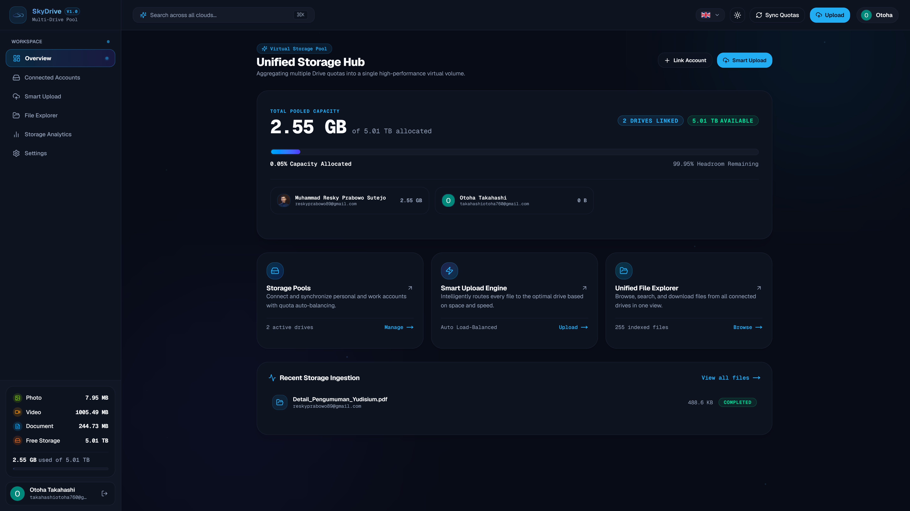

<div align="center">
  
  
  <h3>Satu Ruang Kerja. Seluruh Akun Google Drive Anda. Penyimpanan Awan Cerdas & Bebas Langganan.</h3>
  <p><em>One Workspace. All Your Google Drives. Smart Cloud Storage with True Zero-Retention.</em></p>

  <p>
    <a href="#-bahasa-indonesia">🇮🇩 <strong>Bahasa Indonesia</strong></a> &nbsp;•&nbsp; 
    <a href="#-english">🇬🇧 <strong>English</strong></a>
  </p>
</div>

---

<div align="center">
  
</div>

---

## 🇮🇩 Bahasa Indonesia

### 💡 Latar Belakang & Masalah yang Diselesaikan

Setiap akun Google gratis mendapatkan jatah penyimpanan awan sebesar **15 GB**. Sebagian besar dari kita memiliki lebih dari satu akun—misalnya akun pribadi, email kerja/kantor, email kampus, dan akun cadangan. Jika Anda memiliki 3 sampai 5 akun, sebenarnya Anda memiliki **45 GB hingga 75 GB+ kuota resmi Google Drive secara cuma-cuma**.

Namun, mengelolanya secara manual sangat merepotkan:
- **Dilema File Besar**: Anda ingin mengunggah video 5.0 GB, tetapi gagal karena ketiga akun Anda masing-masing hanya menyisakan 2.0 GB, padahal jika ditotal Anda masih punya 6.0 GB sisa ruang!
- **Repot Gonta-Ganti Tab**: Anda harus membuka 4 tab browser berbeda dan login ulang berkali-kali hanya untuk mencari satu file lama.
- **Biaya Langganan Mahal**: Terpaksa membayar langganan bulanan Google One hanya karena salah satu akun sudah penuh.
- **Kekhawatiran Privasi**: Layanan agregator cloud biasa sering kali menampung file Anda di hard drive server perantara dan menyimpan daftar nama file pribadi Anda di database mereka.

**SkyDrive hadir sebagai solusi pintar tanpa biaya:**  
Menyatukan semua akun Google Drive Anda menjadi **satu kapasitas penyimpanan lega**, otomatis mengarahkan file ke akun yang masih kosong, dan menyediakan penjelajah file satu pintu dengan jaminan **100% Zero-Retention Privacy**.

---

### ✨ Fitur Utama & Keunggulan SkyDrive

#### 1. 🛡️ Zero-Retention Privacy (Privasi Mutlak)
- **0 Byte Data File di Database**: Database server SkyDrive **sama sekali tidak menyimpan nama file, link, thumbnail, ukuran, maupun isi dokumen Anda**.
- **Live Direct Query**: Daftar file dan folder dibaca secara langsung (*live in-memory*) dari Google Drive Anda saat Anda membuka dashboard. Data Anda tetap sepenuhnya milik Anda di Google.

#### 2. ⚡ In-Memory Streaming Data Plane (Tanpa Server Perantara)
- File yang Anda unggah langsung mengalir dari peramban (browser) ke server Google Drive via koneksi terenkripsi.
- SkyDrive **tidak pernah menyimpan salinan fisik file di hard drive perantara**. Tidak ada risiko kebocoran file dari server pihak ketiga.

#### 3. 🌐 Penggabungan Kuota Otomatis (Unified Virtual Pool)
- Satukan akun gratisan (15 GB/akun), akun Google One (100 GB+), hingga akun kampus/institusi (2 TB+).
- Tampilan meteran kapasitas interaktif yang memperlihatkan total kapasitas gabungan, ruang terpakai, dan sisa ruang bebas secara langsung.

#### 4. 🔀 Smart Upload Dispatcher (Unggah Pintar)
Tiga mode alokasi otomatis saat Anda mengunggah file:
- **Paling Luang (Rekomendasi)**: Sistem otomatis mendeteksi sisa ruang di semua akun dan langsung memilih akun Google Drive yang paling lega.
- **Isi Akun Utama Dulu**: Mengisi akun utama Anda terlebih dahulu, lalu otomatis mengalihkan file ke akun cadangan saat akun utama mendekati batas aman.
- **Bagi Rata**: Membagi pengunggahan file secara merata dan bergantian ke setiap akun yang terhubung.

#### 5. 📁 Penjelajah File Terpadu & 3 Tab Lingkup Akses
- Kelola semua file dari seluruh akun Google Drive Anda dalam satu antarmuka yang rapi.
- **3 Tab Lingkup Filter**:
  - **Drive Saya (`user`)**: Menampilkan file milik seluruh akun yang terhubung.
  - **Dibagikan kepada Saya (`sharedWithMe`)**: Menampilkan dokumen yang dibagikan orang lain ke salah satu email Anda.
  - **Drive Bersama (`sharedDrive`)**: Menampilkan Google Shared Drives tim/organisasi.
- Fitur lengkap: Unduh langsung, ganti nama (*rename*), pindah folder (*move*), dan hapus massal (*bulk delete*).

#### 6. 🔍 Pencarian Satu Pintu
- Tidak perlu lagi menebak-nebak di akun Google mana file lama Anda tersimpan. Ketik nama berkas di kolom pencarian, dan SkyDrive akan langsung menemukannya dari seluruh akun Anda.

#### 7. 🔐 Keamanan Kunci Standar Perbankan (AES-256-GCM)
- SkyDrive tidak pernah mengetahui atau meminta kata sandi (*password*) Google Anda. Login dilakukan melalui otorisasi resmi Google OAuth 2.0.
- Kunci token integrasi diamankan dengan enkripsi berlapis `AES-256-GCM`.
- Izin akses dapat Anda putuskan kapan saja hanya dengan 1 klik dari dashboard atau melalui menu Keamanan Akun Google Anda.

#### 8. 🌍 Dukungan 5 Bahasa Internasional
- Didukung penuh dalam **Bahasa Indonesia (`/id`)**, **English (`/en`)**, **日本語 (`/ja`)**, **中文 (`/zh`)**, dan **한국어 (`/ko`)**.
- URL halaman otomatis menyesuaikan bahasa dan didukung *Server-Side Rendering (SSR)* cepat tanpa kedipan layar (*flicker*).

---

### 🚀 Cara Kerja (3 Langkah Mudah)

```text
1. Hubungkan Akun Google   ➔   2. Kapasitas Tergabung Otomatis   ➔   3. Upload & Cari di Satu Tempat
   (Otorisasi resmi OAuth)        (Misal: 3 Akun = 45 GB Bebas)           (File langsung masuk ke Google)
```

---

<br />

## 🇬🇧 English

### 💡 Background & The Problem Solved

Every standard Google account comes with **15 GB of free cloud storage**. Most users maintain 3 to 5 separate Google accounts across personal, university, work, and secondary emails—representing **45 GB to 75 GB+ of official free cloud quota**.

However, managing multiple accounts manually causes constant friction:
- **Quota Fragmentation**: You want to upload a 5.0 GB video, but it fails because each of your 3 accounts only has 2.0 GB left—even though your total combined free space is 6.0 GB!
- **Tab Fatigue & Context Switching**: Hunting for an old document requires jumping between multiple browser tabs and logging in and out repeatedly.
- **Costly Subscriptions**: Paying for monthly cloud plans simply because one single account reached its 15 GB ceiling.
- **Privacy Trade-offs**: Conventional third-party cloud aggregators store copies of your files on their intermediate disks and index personal document metadata in external databases.

**SkyDrive eliminates these limitations without subscription costs:**  
It aggregates all your Google Drive accounts into a **single, unified virtual storage pool**, routes uploads automatically to the drive with available headroom, and searches files across all accounts from one unified dashboard—built with **True Zero-Retention Privacy**.

---

### ✨ Core Features & Highlights

#### 1. 🛡️ True Zero-Retention Privacy
- **0 Bytes of File Metadata in Server Database**: SkyDrive **never stores your file names, file sizes, thumbnails, links, or folder paths in any database**.
- **Live In-Memory Direct Sync**: Your file trees and documents are queried in real time directly from the Google Drive API v3 when you access the dashboard. Your files remain 100% yours on Google.

#### 2. ⚡ In-Memory Streaming Data Plane (Zero Intermediate Storage)
- File uploads and downloads stream in-memory directly between your browser and Google Cloud Storage via backpressure-controlled pipelines.
- SkyDrive **never writes user file binaries to intermediate server disks**. There is zero risk of data residue or file leaks on third-party hardware.

#### 3. 🌐 Unified Virtual Storage Pool
- Seamlessly combine free accounts (15 GB each), Google One tiers (100 GB+), or Google Workspace / Edu accounts (2 TB+).
- Visual interactive storage gauge showing real-time combined pool capacity, total space used, and leftover headroom.

#### 4. 🔀 Smart Upload Dispatcher
Three intelligent routing strategies when you upload:
- **Best Fit (Recommended)**: Automatically checks available space across all linked accounts and routes files to the Google Drive with the most headroom.
- **Tiered Spillover**: Fills your primary drive up to a safe threshold (85%), then smoothly spills new uploads over to your secondary backup drives.
- **Round Robin**: Balances file uploads evenly across all connected accounts.

#### 5. 📁 Unified File Explorer & 3-Scope Switcher
- View and manage files across all your Google Drive accounts in one fluid, high-performance table.
- **3 Scope Filters**:
  - **My Drive (`user`)**: Personal files owned by your connected accounts.
  - **Shared with Me (`sharedWithMe`)**: Files shared to any of your emails by collaborators.
  - **Shared Drives (`sharedDrive`)**: Institutional and team shared drives.
- Complete operations: In-browser streaming download, renaming, moving across folders, and multi-file bulk deletion.

#### 6. 🔍 Single-Door Global Search
- Stop guessing which Google account contains your file. Type the filename in the search bar, and SkyDrive finds it across all your linked drives in milliseconds.

#### 7. 🔐 Bank-Grade AES-256-GCM Token Encryption
- SkyDrive never asks for or sees your Google password. Authentication is handled via official Google OAuth 2.0.
- OAuth access and refresh keys are encrypted at rest using authenticated `AES-256-GCM` with unique initialization vectors (IV).
- Revoke access anytime with 1 click directly from the dashboard or through [myaccount.google.com](https://myaccount.google.com/permissions).

#### 8. 🌍 First-Class 5-Language Localization
- Available in **Indonesian (`/id`)**, **English (`/en`)**, **Japanese (`/ja`)**, **Chinese (`/zh`)**, and **Korean (`/ko`)**.
- Clean URL routing with automatic browser language detection and instant Server-Side Rendering (SSR).

---

### 🚀 How It Works (3 Simple Steps)

```text
1. Link Your Google Accounts   ➔   2. Storage Pools Automatically   ➔   3. Upload & Search in One Place
    (Official Google OAuth)           (e.g., 3 Accounts = 45 GB Free)          (Files stored safely on Google)
```

---

<div align="center">
  <p><strong>SkyDrive</strong> · Built for seamless multi-account cloud productivity.</p>
</div>
