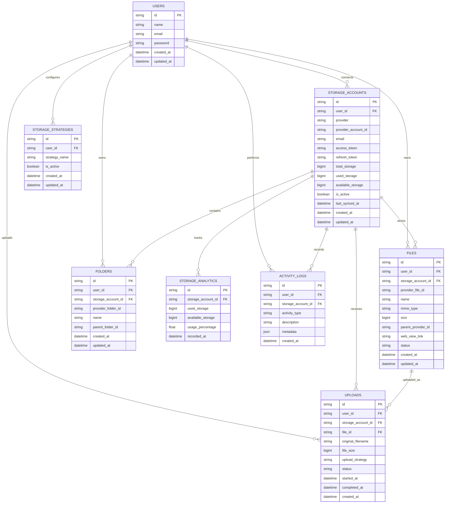

# ☁️ SkyDrive

> **One workspace. All your Google Drives. Smarter storage.**

SkyDrive is a unified cloud storage management platform that allows users to connect and manage multiple cloud storage accounts from a single dashboard.

The platform is initially focused on Google Drive integration, allowing users to connect multiple Google accounts, monitor storage usage, upload files, search files across accounts, and intelligently select the best storage account for new uploads.

Instead of manually switching between multiple Google accounts, SkyDrive provides a centralized workspace for managing distributed cloud storage.

---

## 📌 Table of Contents

* [About](#-about)
* [Problem](#-problem)
* [Solution](#-solution)
* [Project Goals](#-project-goals)
* [Target Users](#-target-users)
* [Core Features](#-core-features)
* [User Flow](#-user-flow)
* [System Architecture](#-system-architecture)
* [Smart Storage Algorithm](#-smart-storage-algorithm)
* [Database Design](#-database-design)
* [Entity Relationship Diagram](#-entity-relationship-diagram)
* [Database Relationships](#-database-relationships)
* [Tech Stack](#-tech-stack)
* [Authentication and OAuth](#-authentication-and-oauth)
* [Google Drive Integration](#-google-drive-integration)
* [Project Structure](#-project-structure)
* [API Design](#-api-design)
* [Development Roadmap](#-development-roadmap)
* [MVP](#-minimum-viable-product)
* [Future Features](#-future-features)
* [Challenges](#-technical-challenges)
* [Learning Objectives](#-learning-objectives)

---

# 📖 About

## What is SkyDrive?

SkyDrive is a web-based cloud storage management platform designed for users who own multiple cloud storage accounts.

Many users have more than one Google account for different purposes.

For example:

```text
account1@gmail.com
account2@gmail.com
account3@gmail.com
archive@gmail.com
```

Each account has its own Google Drive storage.

The problem is that users need to switch between accounts to:

* Check available storage
* Upload files
* Search files
* Manage folders
* Monitor storage usage

SkyDrive solves this problem by providing a single interface that connects multiple Google Drive accounts.

```text
                    ┌──────────────────┐
                    │    SkyDrive     │
                    │                  │
                    │ Unified Dashboard│
                    └────────┬─────────┘
                             │
          ┌──────────────────┼──────────────────┐
          │                  │                  │
          ▼                  ▼                  ▼
   Google Account 1   Google Account 2   Google Account 3
          │                  │                  │
          ▼                  ▼                  ▼
      Google Drive       Google Drive       Google Drive
```

---

# ❗ Problem

## The Real Problem

Cloud storage users often create multiple accounts because one storage account is not enough.

For example:

```text
Account 1 (Primary)

Storage:
15 GB


Account 2 (Secondary)

Storage:
15 GB


Account 3 (Workspace)

Storage:
15 GB


Archive Account

Storage:
15 GB
```

Although the total storage capacity is large, it is distributed across multiple accounts.

This creates several problems.

### 1. Multiple Account Switching

Users need to repeatedly log in and switch between accounts.

```text
Login Account A

↓

Check Storage

↓

Logout

↓

Login Account B

↓

Check Storage

↓

Upload File
```

This process is inefficient.

---

### 2. Storage Visibility Problem

Users may not know which account still has available storage.

Example:

```text
Account A

95% Used


Account B

40% Used


Account C

70% Used
```

Without a centralized dashboard, users need to manually check every account.

---

### 3. File Location Problem

Users may forget where a file is stored.

Example:

```text
Where is my project archive?

Account 1?

Account 2?

Archive Drive?

External Storage?
```

This makes file management difficult.

---

### 4. Inefficient Storage Distribution

Users may accidentally upload too many files to one account.

```text
Account A

95% Used


Account B

20% Used


Account C

10% Used
```

Storage distribution becomes inefficient.

---

### 5. No Unified File Search

Users cannot easily search all connected storage accounts from one place.

Instead, they need to search each Google Drive individually.

---

# 💡 Solution

SkyDrive provides a unified cloud storage management system.

Users can:

```text
Connect Multiple Accounts
          ↓
View Storage Usage
          ↓
Upload Files
          ↓
Choose Storage Automatically
          ↓
Search Files Globally
          ↓
Manage Files From One Dashboard
```

The platform acts as a centralized management layer between users and their cloud storage accounts.

---

# 🎯 Project Goals

The main goal of SkyDrive is to simplify multi-account cloud storage management.

The system aims to:

* Reduce account switching
* Provide centralized storage monitoring
* Simplify file searching
* Improve storage distribution
* Automatically select suitable storage accounts
* Provide storage analytics
* Create a unified cloud storage experience

---

# 👥 Target Users

SkyDrive is engineered for:

## Software Engineers & Cloud Architects

Engineers managing multiple Google accounts for:

* Repository asset & binary backups
* Environment dumps & database snapshots
* Machine learning datasets & model checkpoints
* Build artifacts and distribution packages

---

## Media Studios & Creative Directors

Creative teams managing high-volume cloud storage for:

* RAW video footage and 4K production masters
* Project deliverables and client assets
* Large format graphic design archives
* Long-term redundant backups

---

## Multi-Account Cloud Power Users

Professionals and organizations requiring:

* Segregated workspaces per project domain
* Pooled capacity aggregation without extra storage subscription costs
* Centralized search and file management across distributed drives

---

# ✨ Core Features

## 1. Multi Google Drive Connection

Users can connect multiple Google Drive accounts.

Example:

```text
Connected Accounts

├── account1@gmail.com
│
├── account2@gmail.com
│
├── account3@gmail.com
│
└── archive@gmail.com
```

Each account is connected using Google OAuth 2.0.

### Connection Flow

```text
User

↓

Connect Google Account

↓

Google OAuth

↓

User Grants Permission

↓

Google Account Connected

↓

Storage Information Retrieved
```

---

# 2. Unified Storage Dashboard

The dashboard displays storage information from all connected accounts.

Example:

```text
Connected Accounts

4 Accounts


Total Storage

60 GB


Used Storage

42 GB


Available Storage

18 GB
```

Per account:

```text
Account                 Used          Available

account1@gmail.com      12 GB         3 GB

account2@gmail.com      10 GB         5 GB

account3@gmail.com      18 GB         2 GB

archive@gmail.com        2 GB        13 GB
```

---

# 3. Storage Usage Visualization

Users can view storage usage visually.

Example:

```text
account1@gmail.com

████████████████░░░░

80% Used


archive@gmail.com

████░░░░░░░░░░░░░░

20% Used
```

The dashboard can display:

* Total storage
* Used storage
* Available storage
* Storage percentage
* Most used account
* Least used account

---

# 4. Multi-Account File Upload

Users can upload files through SkyDrive.

Before uploading, users can choose:

```text
Upload Destination

○ Select Account Manually

○ Largest Available Storage

○ Least Used Storage

○ Balanced Storage
```

---

# 5. Smart Storage Allocation

This is one of the main features of SkyDrive.

The system automatically determines the best storage account.

Example:

```text
Upload File

project-backup.zip

Size: 4 GB


Connected Accounts


Account A

Available:
2 GB

❌ Cannot Store File


Account B

Available:
10 GB

✓ Available


Account C

Available:
6 GB

✓ Available
```

The system selects the best account based on the selected storage strategy.

---

# 6. Unified File Explorer

Users can view files from multiple accounts in one interface.

Example:

```text
All Files


📄 Report.pdf

Storage:
account2@gmail.com


📄 Project.zip

Storage:
account1@gmail.com


📄 Dataset.csv

Storage:
archive@gmail.com
```

Users can identify which storage account contains each file.

---

# 7. Global File Search

Users can search files across all connected accounts.

Example:

```text
Search:

skripsi
```

The system searches every connected Google Drive account.

Result:

```text
Report Final.pdf

Account:
account2@gmail.com


Report Backup.pdf

Account:
archive@gmail.com
```

---

# 8. Upload History

Every upload activity is recorded.

Example:

```text
project.zip

Size:
2.4 GB

Uploaded To:
backup@gmail.com

Strategy:
Largest Free Storage

Status:
Completed

Date:
30 August 2026
```

---

# 9. Storage Analytics

SkyDrive provides analytics about storage usage.

Users can view:

* Storage growth
* Account comparison
* Storage distribution
* Upload activity
* Most active account
* Available storage trends

Example:

```text
Storage Usage Trend

January

10 GB


February

14 GB


March

18 GB


April

23 GB
```

---

# 10. Storage Alerts

The system can notify users when storage is almost full.

Example:

```text
⚠ Storage Alert

account2@gmail.com

Storage usage has reached:

92%

Recommendation:

Use another connected account
for future uploads.
```

---

# 🔄 User Flow

## Basic User Flow

```text
User Registration
        │
        ▼
User Login
        │
        ▼
Connect Google Account
        │
        ▼
Google OAuth
        │
        ▼
Account Connected
        │
        ▼
Retrieve Storage Information
        │
        ▼
Dashboard
        │
        ├── View Storage
        │
        ├── Upload File
        │
        ├── Search File
        │
        ├── View Analytics
        │
        └── Manage Accounts
```

---

# 🏗️ System Architecture

```text
                              USER
                                │
                                ▼
                    ┌──────────────────────┐
                    │      RESKCLOUD       │
                    │                      │
                    │       NEXT.JS        │
                    │                      │
                    │ • Authentication     │
                    │ • Dashboard          │
                    │ • File Explorer      │
                    │ • File Upload        │
                    │ • Storage Analytics  │
                    └──────────┬───────────┘
                               │
                 ┌─────────────┼─────────────┐
                 │             │             │
                 ▼             ▼             ▼
          ┌────────────┐ ┌────────────┐ ┌────────────┐
          │   MySQL    │ │ Google API │ │ Background │
          │            │ │            │ │ Processing │
          └────────────┘ └────────────┘ └────────────┘
                 │             │             │
                 ▼             ▼             ▼
            Application      Google Drive    Redis
               Data
```

---

# 🧠 Smart Storage Algorithm

The smart storage system determines the best account for file uploads.

SkyDrive supports multiple strategies.

---

## Strategy 1: Manual Selection

The user manually selects an account.

```text
Upload File

↓

Select Account

↓

Upload
```

Example:

```text
Choose Account

○ account1@gmail.com

○ account2@gmail.com

● archive@gmail.com
```

---

## Strategy 2: Largest Available Storage

The system selects the account with the largest available storage.

Example:

```text
Account A

Available:
3 GB


Account B

Available:
12 GB


Account C

Available:
8 GB
```

Selected:

```text
Account B
```

### Algorithm

```text
1. Get active accounts

2. Check available storage

3. Filter accounts that can store the file

4. Sort by available storage

5. Select the largest available storage

6. Upload file
```

Pseudo code:

```typescript
const availableAccounts = accounts
  .filter(
    (account) =>
      account.availableStorage >= fileSize
  )
  .sort(
    (a, b) =>
      b.availableStorage -
      a.availableStorage
  );

const selectedAccount =
  availableAccounts[0];
```

---

## Strategy 3: Least Used Storage

The system selects the account with the lowest storage usage percentage.

Example:

```text
Account A

Used:
80%


Account B

Used:
30%


Account C

Used:
50%
```

Selected:

```text
Account B
```

---

## Strategy 4: Balanced Storage

This strategy attempts to distribute files evenly.

Example:

Before upload:

```text
Account A

70% Used


Account B

30% Used


Account C

50% Used
```

The system chooses Account B.

The goal is to prevent one account from becoming full while others remain mostly empty.

---

# 🗄️ Database Design

SkyDrive uses a relational database because the application contains clear relationships between:

* Users
* Storage accounts
* Files
* Folders
* Upload history
* Storage analytics
* Activity logs

The recommended database is:

```text
MySQL
+
Prisma ORM
```

---

# 🧩 Entity Relationship Diagram



---

# 🔗 Database Relationships

## Users → Storage Accounts

One user can connect multiple cloud accounts.

```text
User

│

├── Google Account 1

├── Google Account 2

├── Google Account 3

└── Google Account 4
```

Relationship:

```text
One User

↓

Many Storage Accounts
```

---

## Storage Accounts → Files

Each connected account contains multiple files.

```text
Storage Account

│

├── Thesis.pdf

├── Project.zip

├── Dataset.csv

└── Photo.jpg
```

Relationship:

```text
One Storage Account

↓

Many Files
```

---

## Storage Accounts → Folders

Each storage account contains multiple folders.

```text
Storage Account

│

├── Documents

├── Projects

├── Photos

└── Backups
```

---

## Files → Upload History

Each uploaded file has upload information.

```text
File

↓

Upload Record

↓

Storage Account

↓

Upload Strategy

↓

Upload Status
```

---

## Storage Accounts → Storage Analytics

The system periodically stores storage usage.

Example:

```text
1 August

Used:
10 GB


15 August

Used:
12 GB


30 August

Used:
14 GB
```

This data can be used to generate storage usage charts.

---

# 🔐 Authentication and OAuth

SkyDrive has two different authentication concepts.

## Application Authentication

This is used to authenticate users into SkyDrive.

```text
User

↓

Login

↓

Authenticated

↓

Access Dashboard
```

Recommended technology:

```text
Better Auth
```

---

## Google Account Authorization

This is used to connect Google Drive accounts.

```text
User

↓

Connect Google Account

↓

Google OAuth

↓

Grant Permission

↓

Access Token

↓

Refresh Token

↓

Google Drive Connected
```

A user can connect multiple Google accounts.

This is different from the main application login.

---

# 🔑 OAuth Flow

```text
User
 │
 ▼
SkyDrive
 │
 ▼
Connect Google Account
 │
 ▼
Google Authorization Page
 │
 ▼
User Login
 │
 ▼
User Grants Permission
 │
 ▼
Authorization Code
 │
 ▼
SkyDrive Backend
 │
 ▼
Access Token
+
Refresh Token
 │
 ▼
Save Securely
 │
 ▼
Google Drive Connected
```

---

# 🔒 Security Considerations

Because SkyDrive handles OAuth tokens, security is important.

The application should:

* Encrypt sensitive tokens
* Never expose refresh tokens to the frontend
* Store tokens securely
* Use environment variables
* Use HTTPS
* Implement token expiration handling
* Limit OAuth permissions
* Validate authenticated users
* Implement rate limiting
* Log suspicious activity

Sensitive information should never be directly exposed in client-side code.

---

# 🛠️ Tech Stack

## Frontend and Full Stack Framework

```text
Next.js
React
TypeScript
App Router
```

Why:

* Full-stack development
* Server-side rendering
* Route handlers
* Server components
* API integration
* Strong TypeScript support

---

## UI and Styling

```text
Tailwind CSS

shadcn/ui

Lucide React
```

Used for:

* Dashboard
* Tables
* Dialogs
* Forms
* Navigation
* File explorer interface
* Storage visualization

---

## Database

```text
MySQL
Prisma ORM
```

MySQL stores:

* User data
* Connected accounts
* File metadata
* Upload history
* Storage analytics
* Activity logs
* User preferences

Prisma is used for:

* Database queries
* Schema management
* Migrations
* Type-safe database access

---

## Authentication

```text
Better Auth
```

Used for:

* User registration
* Login
* Session management
* Authentication

---

## Google Integration

```text
Google OAuth 2.0

Google Drive API

Google APIs Node.js Client
```

Used for:

* Connecting Google accounts
* Retrieving storage information
* Uploading files
* Searching files
* Managing file metadata

---

## Background Processing

```text
Redis

BullMQ
```

Used for:

* Storage synchronization
* Large file uploads
* Scheduled analytics
* Background tasks
* File metadata synchronization

This is optional for the first version.

---

## Data Visualization

```text
Recharts
```

Used for:

* Storage usage charts
* Storage distribution
* Upload trends
* Account comparison

---

# 📦 Complete Tech Stack

```text
Frontend & Full Stack
│
├── Next.js
├── React
├── TypeScript
└── App Router


UI
│
├── Tailwind CSS
├── shadcn/ui
└── Lucide React


Database
│
├── MySQL
└── Prisma ORM


Authentication
│
└── Better Auth


Cloud Integration
│
├── Google OAuth 2.0
├── Google Drive API
└── googleapis


Background Jobs
│
├── Redis
└── BullMQ


Data Visualization
│
└── Recharts


Deployment
│
├── Vercel
├── Railway
└── MySQL Database
```

---

# 📁 Project Structure

```text
reskcloud/

├── app/
│
│   ├── (auth)/
│   │   │
│   │   ├── login/
│   │   │   └── page.tsx
│   │   │
│   │   └── register/
│   │       └── page.tsx
│   │
│   ├── dashboard/
│   │   │
│   │   ├── page.tsx
│   │   │
│   │   ├── accounts/
│   │   │   └── page.tsx
│   │   │
│   │   ├── files/
│   │   │   └── page.tsx
│   │   │
│   │   ├── uploads/
│   │   │   └── page.tsx
│   │   │
│   │   ├── analytics/
│   │   │   └── page.tsx
│   │   │
│   │   └── settings/
│   │       └── page.tsx
│   │
│   └── api/
│       │
│       ├── auth/
│       │
│       ├── google/
│       │   │
│       │   ├── connect/
│       │   ├── callback/
│       │   ├── disconnect/
│       │   └── sync/
│       │
│       ├── files/
│       │   │
│       │   ├── upload/
│       │   ├── search/
│       │   ├── download/
│       │   └── delete/
│       │
│       └── storage/
│           │
│           ├── analytics/
│           └── sync/
│
├── components/
│   │
│   ├── ui/
│   │
│   ├── dashboard/
│   │
│   ├── accounts/
│   │
│   ├── files/
│   │
│   ├── upload/
│   │
│   └── analytics/
│
├── lib/
│   │
│   ├── db.ts
│   │
│   ├── auth.ts
│   │
│   ├── google-drive.ts
│   │
│   ├── storage-algorithm.ts
│   │
│   └── utils.ts
│
├── services/
│   │
│   ├── account-service.ts
│   │
│   ├── storage-service.ts
│   │
│   ├── file-service.ts
│   │
│   ├── upload-service.ts
│   │
│   └── analytics-service.ts
│
├── prisma/
│   │
│   └── schema.prisma
│
├── workers/
│   │
│   ├── storage-sync-worker.ts
│   │
│   └── analytics-worker.ts
│
└── types/
    │
    ├── account.ts
    ├── file.ts
    └── storage.ts
```

---

# 🔌 API Design

## Google Account API

### Connect Account

```text
GET

/api/google/connect
```

Purpose:

```text
Start Google OAuth authorization
```

---

### OAuth Callback

```text
GET

/api/google/callback
```

Purpose:

```text
Receive authorization result
```

---

### Disconnect Account

```text
DELETE

/api/google/disconnect
```

Purpose:

```text
Remove connected Google account
```

---

# 📁 File API

## Upload File

```text
POST

/api/files/upload
```

Request:

```text
file
strategy
accountId
```

---

## Search Files

```text
GET

/api/files/search
```

Example:

```text
/api/files/search?q=skripsi
```

---

## Download File

```text
GET

/api/files/[id]/download
```

---

## Delete File

```text
DELETE

/api/files/[id]
```

---

# 📊 Storage API

## Synchronize Storage

```text
POST

/api/storage/sync
```

Purpose:

```text
Retrieve latest storage information
from connected accounts
```

---

## Storage Analytics

```text
GET

/api/storage/analytics
```

Purpose:

```text
Retrieve storage usage statistics
```

---

# 🚀 Development Roadmap

## Phase 1 — Project Setup

```text
[ ] Initialize Next.js

[ ] Configure TypeScript

[ ] Install Tailwind CSS

[ ] Install shadcn/ui

[ ] Setup MySQL

[ ] Configure Prisma

[ ] Create database schema
```

---

## Phase 2 — Authentication

```text
[ ] User registration

[ ] User login

[ ] Session management

[ ] Protected dashboard routes
```

---

## Phase 3 — Google Integration

```text
[ ] Create Google Cloud Project

[ ] Configure OAuth

[ ] Connect Google account

[ ] Save account information

[ ] Retrieve storage quota

[ ] Disconnect account
```

---

## Phase 4 — Storage Dashboard

```text
[ ] Connected account list

[ ] Storage information

[ ] Total storage calculation

[ ] Used storage calculation

[ ] Available storage calculation

[ ] Storage usage chart
```

---

## Phase 5 — File Upload

```text
[ ] Upload interface

[ ] Manual account selection

[ ] Upload to Google Drive

[ ] Upload history

[ ] Upload status
```

---

## Phase 6 — Smart Storage

```text
[ ] Largest storage strategy

[ ] Least used strategy

[ ] Balanced storage strategy

[ ] Automatic account selection
```

---

## Phase 7 — File Explorer

```text
[ ] File listing

[ ] Account identification

[ ] Global file search

[ ] File filtering

[ ] File metadata
```

---

## Phase 8 — Analytics

```text
[ ] Storage trend

[ ] Upload history

[ ] Account comparison

[ ] Storage distribution

[ ] Storage alerts
```

---

# 🎯 Minimum Viable Product

The first version of SkyDrive should focus only on essential features.

```text
Authentication
       │
       ▼
Connect Multiple Google Accounts
       │
       ▼
Display Storage Information
       │
       ▼
Upload File
       │
       ▼
Manual Storage Selection
       │
       ▼
Upload History
```

MVP architecture:

```text
Next.js

↓

MySQL

↓

Google OAuth

↓

Google Drive API
```

---

# 🔥 Version 2 Features

After the MVP is stable:

```text
Smart Storage Allocation

↓

Unified File Explorer

↓

Global File Search

↓

Storage Analytics

↓

Storage Alerts
```

---

# 🚀 Future Features

## Google Workspace & Shared Drives Expansion

Future versions could support:

```text
Google Drive (Personal Accounts)

Google Workspace (Business & Enterprise)

Google Shared Drives (Team Drives)

Google Education & Campus Drives
`

Architecture:

```text
                 SkyDrive

                     │

        ┌────────────┼────────────┐

        ▼            ▼            ▼

   Personal Drive  Workspace    Shared Drive
```

---

## File Transfer Between Accounts

Example:

```text
Account A

95% Used

        │

        ▼

Move Large Files

        │

        ▼

Account B

30% Used
```

---

## Automatic Storage Balancing

The system automatically distributes files.

Example:

```text
Before

Account A

90%


Account B

20%


Account C

30%
```

After optimization:

```text
Account A

60%


Account B

50%


Account C

45%
```

---

## File Recommendation

The system could analyze files and recommend storage locations.

Example:

```text
Large Video Files

↓

Backup Account


Academic Documents

↓

Secondary Account


Project Files

↓

Development Account
```

---

## Duplicate File Detection

Detect duplicate files across different accounts.

Example:

```text
project.zip

Found in:

account1@gmail.com

archive@gmail.com
```

Recommendation:

```text
Potential duplicate file detected.
```

---

# ⚠️ Technical Challenges

This project contains several technical challenges.

## OAuth Token Management

The application needs to manage:

```text
Access Token

Refresh Token

Expiration

Token Refresh
```

---

## Multiple Account Management

The system must handle:

```text
One User

↓

Multiple Google Accounts

↓

Different Tokens

↓

Different Storage Quotas

↓

Different File Lists
```

---

## File Upload

Large file uploads require special handling.

Potential problems:

* Network interruption
* Upload failure
* Token expiration
* File size
* Progress tracking

---

## Storage Synchronization

Storage information can change outside the application.

Example:

```text
User uploads file directly
to Google Drive.

↓

SkyDrive database
becomes outdated.

↓

Synchronization required.
```

---

# 📚 Learning Objectives

By building SkyDrive, the developer will gain experience with:

```text
Next.js

TypeScript

Full Stack Development

REST API

OAuth 2.0

Third Party API Integration

Google Drive API

Database Design

MySQL

Prisma ORM

Authentication

File Upload

Background Jobs

Redis

Dashboard Development

Data Visualization

Cloud Architecture
```

---

# 🧠 Why This Project?

SkyDrive is designed to be more than a simple CRUD application.

The project demonstrates the integration of multiple software engineering concepts.

```text
Authentication
        +
OAuth Integration
        +
Third Party API
        +
Multi Account Management
        +
Cloud Storage
        +
Database Architecture
        +
Smart Storage Algorithm
        +
File Management
        +
Analytics Dashboard
```

This makes SkyDrive a strong portfolio project for demonstrating modern full-stack development skills.

---

# 📈 Portfolio Value

SkyDrive demonstrates experience in:

| Skill                  | Implementation           |
| ---------------------- | ------------------------ |
| Full Stack Development | Next.js                  |
| Frontend Development   | React + TypeScript       |
| Database               | MySQL + Prisma           |
| Authentication         | Better Auth              |
| OAuth                  | Google OAuth 2.0         |
| API Integration        | Google Drive API         |
| File Management        | Upload and file metadata |
| Algorithms             | Smart storage allocation |
| Background Jobs        | Redis + BullMQ           |
| Analytics              | Storage visualization    |

---

# 🗺️ Project Vision

The long-term vision of SkyDrive is to become a unified cloud storage management platform.

```text
Today

Multiple Google Drive Accounts

        ↓

SkyDrive

        ↓

Unified Storage Management
```

Future vision:

```text
Personal Google Drive
      │
Secondary Google Drive
      │
Workspace / School Drive
      │
      ▼
  SkyDrive
      │
      ▼
Unified Storage Workspace
```

---

# 👨‍💻 Author

Engineered as a production-grade portfolio platform focused on:

**Modern Full-Stack Development, Cloud Integration, OAuth Authentication, Multi-Account Management, and Intelligent Storage Management.**

---

## ⭐ Project Status

```text
Planning Phase
```

Future status:

```text
Planning
   ↓
Development
   ↓
MVP
   ↓
Beta
   ↓
Production
```

---

> **SkyDrive — One workspace. All your Google Drives. Smarter storage.**
